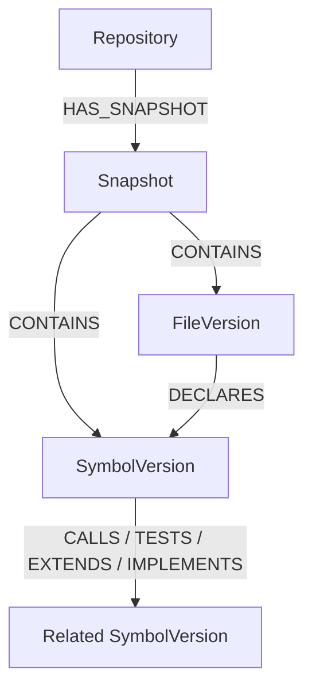

# PROPOSAL TUGAS AKHIR / PROYEK AKHIR

**Judul Penelitian:**  
**Rancang Bangun Sistem *Automated Pull Request Code Reviewer* Berbasis *Structural Graph Retrieval* (Neo4j) dan *Large Language Model* (Gemini)**

---

## IDENTITAS PENGUSUL
- **Nama Mahasiswa:** [Nama Anda]
- **Nomor Induk Mahasiswa (NIM):** [NIM Anda]
- **Program Studi:** [Teknik Informatika / Ilmu Komputer / Rekayasa Perangkat Lunak]
- **Fakultas:** [Fakultas Anda]
- **Calon Dosen Pembimbing:** [Nama Dosen Pembimbing]

---

## RINGKASAN EKSEKUTIF
Proses *code review* pada alur kerja pengembangan perangkat lunak modern (khususnya *Pull Request* di GitHub) merupakan tahap krusial untuk menjaga kualitas, keamanan, dan keandalan kode. Namun, *code review* manual sering kali menjadi *bottleneck* karena memakan waktu dan membutuhkan konsentrasi tinggi dari *senior engineer*. Pemanfaatan *Large Language Model* (LLM) komersial untuk meninjau kode saat ini menghadapi kendala mendasar: **keterbatasan konteks arsitektur (*context blindness*)**. LLM yang hanya menerima potongan kode yang berubah (*unified git diff*) tidak dapat memahami dampak perubahan tersebut terhadap modul lain di luar diff, sedangkan mengirimkan seluruh berkas *repository* ke LLM terkendala biaya, latensi, dan batas token (*context window*).

Penelitian ini mengusulkan solusi berupa **GraphMethod AI Pull Request Reviewer**, sebuah sistem otomasi *code review* berbasis GitHub App yang memadukan analisis statis *Abstract Syntax Tree* (AST), basis data graf **Neo4j** (*Structural Graph Retrieval*), dan LLM **Google Gemini**. Sistem ini mengekstraksi relasi fungsional kode (pemanggilan fungsi, pewarisan kelas, implementasi antarmuka, dan pengujian) ke dalam representasi graf. Ketika *Pull Request* diajukan, sistem secara dinamis menelusuri graf untuk mengambil konteks kode yang terdampak langsung dan menyuntikkannya ke LLM dengan batasan token yang ketat. Hasil evaluasi langsung dikirimkan kembali ke antarmuka GitHub dalam bentuk *inline comments*, saran kode (*code suggestions*), dan ringkasan dampak arsitektur secara otomatis.

---

## BAB I: PENDAHULUAN

### 1.1 Latar Belakang
Dalam rekayasa perangkat lunak modern, metodologi *Continuous Integration/Continuous Deployment* (CI/CD) menuntut siklus rilis yang cepat tanpa mengorbankan kualitas perangkat lunak. Praktik *peer code review* melalui *Pull Request* (PR) terbukti efektif menurunkan *defect density*, namun proses ini sangat bergantung pada ketersediaan peninjau manusia (*reviewer fatigue*), rawan inkonsistensi, dan kerap memperlambat *time-to-market*.

Kehadiran *Large Language Models* (LLM) seperti GPT-4 dan Google Gemini membuka potensi otomasi tinjauan kode. Namun, penerapan LLM pada *code review* di tingkat *production repository* memiliki tantangan spesifik:
1. **Kurangnya Konteks Global (*Context Blindness*):** Perubahan 5 baris fungsi pada berkas A sering kali merusak pemanggil (*caller*) pada berkas B dan C. Jika LLM hanya membaca teks *diff* lokal, LLM tidak mampu mendeteksi *breaking changes* tersebut.
2. **Keterbatasan Pendekatan Vector RAG Konvensional:** Penggunaan *Retrieval-Augmented Generation* (RAG) berbasis kemiripan teks/vektor (*vector embeddings*) kurang efektif untuk kode program. Hubungan antar kode bersifat deterministik dan struktural (misal: relasi pewarisan dan pemanggilan fungsi), bukan kemiripan semantik teks semata.
3. **Halusinasi dan Komentar Bersifat Dangkal (*Style Nitpicking*):** Tanpa batasan instruksi dan konteks yang terstruktur, LLM cenderung mengomentari gaya penulisan (*code style*) yang sebenarnya dapat diselesaikan oleh *linter*, alih-alih menemukan cacat logika dan keamanan kritis.

Untuk mengatasi persoalan di atas, diperlukan pendekatan **Graph-based Code Retrieval**. Dengan memodelkan kode ke dalam *Code Property Graph* di dalam basis data graf (Neo4j), sistem dapat menelusuri rantai dependensi dari baris yang diubah dan memberikan konteks yang tepat sasaran ke LLM.

### 1.2 Rumusan Masalah
1. Bagaimana merancang arsitektur sistem *code review* otomatis yang terintegrasi secara mulus (*seamless*) dengan siklus hidup *Pull Request* di GitHub?
2. Bagaimana memodelkan dan mengekstraksi struktur dependensi kode program (khususnya bahasa Python) ke dalam basis data graf Neo4j menggunakan *Abstract Syntax Tree* (AST)?
3. Bagaimana mekanisme *structural graph traversal* dapat memilih konteks kode yang paling relevan di sekitar baris yang berubah dengan memperhatikan anggaran token (*token budget*) LLM?
4. Bagaimana mengarahkan LLM agar menghasilkan temuan yang terfokus pada cacat logika (*correctness*), keamanan (*security*), keandalan (*reliability*), dan konkurensi dengan tingkat presisi tinggi tanpa halusinasi?

### 1.3 Batasan Masalah
1. Bahasa pemrograman target yang diindeks secara struktural pada penelitian ini dibatasi pada **Python (>= 3.12)**.
2. Integrasi sistem diimplementasikan sebagai **GitHub App** yang beroperasi pada event *Pull Request* (`opened`, `synchronize`, `reopened`, `ready_for_review`).
3. Model LLM yang digunakan adalah keluarga **Google Gemini** (seperti `gemini-3.8-flash` / `gemini-3.7-flash`) via REST API terstruktur (JSON schema).
4. Peninjauan difokuskan pada cacat fungsional, keamanan, konkurensi, dan kompatibilitas; tidak mencakup saran gaya penulisan (*formatting/style*) yang telah dicakup oleh perkakas *linter*.

### 1.4 Tujuan Penelitian
1. Mengembangkan sistem otomasi *code review* berbasis *event-driven* (FastAPI, PostgreSQL Job Queue, dan Worker) yang terintegrasi dengan GitHub App API.
2. Membangun modul *indexer* AST Python untuk merepresentasikan kode ke dalam *graph snapshot* di Neo4j dengan relasi `CALLS`, `TESTS`, `EXTENDS`, `IMPLEMENTS`, dan `REFERENCES`.
3. Mengimplementasikan algoritma *seed-and-traverse retrieval* untuk mengekstrak simbol kode terkait perubahan secara efisien sesuai *budget token*.
4. Menguji dan mengevaluasi efektivitas sistem dalam mendeteksi potensi *defect* dan *incompatibility* lintas berkas pada skenario *Pull Request* nyata.

### 1.5 Manfaat Penelitian
- **Bagi Pengembang & Industri:** Mempercepat siklus *review* kode, mengurangi beban kognitif *senior engineer*, serta mencegah *bug* dan regresi arsitektur masuk ke cabang utama (*main branch*).
- **Bagi Akademisi:** Memberikan kontribusi studi empiris mengenai integrasi *Graph-RAG* dalam rekayasa perangkat lunak, khususnya efektivitas graf struktural dibanding penelusuran vektor untuk pemahaman kode oleh LLM.

---

## BAB II: LANDASAN TEORI & KAJIAN PUSTAKA

### 2.1 Automated Code Review
*Code review* adalah pemeriksaan sistematis terhadap kode sumber perangkat lunak untuk mengidentifikasi kesalahan dan meningkatkan kualitas perangkat lunak sebelum digabungkan (*merge*). Otomasi *code review* bertujuan memberikan umpan balik seketika (*instant feedback*) kepada pengembang.

### 2.2 Abstract Syntax Tree (AST) dan Code Graph
*Abstract Syntax Tree* (AST) adalah representasi pohon dari struktur sintaksis abstrak dari kode sumber. Berbeda dengan teks mentah, AST memungkinkan pengenalan entitas kode seperti fungsi, kelas, parameter, dan ekspresi pemanggilan. Relasi antar entitas ini dapat dipetakan ke dalam bentuk graf berarah (*Directed Graph*), di mana simpul (*node*) merepresentasikan entitas kode dan sisi (*edge*) merepresentasikan relasi dependensi.

### 2.3 Graph-based Retrieval-Augmented Generation (Graph-RAG)
RAG adalah teknik melengkapi prompt LLM dengan data eksternal yang relevan. Pada Graph-RAG, informasi tidak diambil berdasarkan *semantic vector distance*, melainkan melalui penelusuran graf (*graph traversal*). Dalam konteks kode program, Graph-RAG menjamin bahwa konteks yang diberikan kepada LLM memiliki kaitan dependensi logis yang pasti (*deterministic relationship*).

### 2.4 Google Gemini dan Structured Output
Google Gemini mendukung inferensi cepat dengan jendela konteks besar dan fitur *Structured Output* (skema JSON terikat). Fitur ini krusial agar respons tinjauan kode dapat langsung dipetakan ke objek program (nomor baris, tingkat keparahan, saran perbaikan) tanpa risiko kegagalan *parsing* teks bebas.

---

## BAB III: METODOLOGI DAN PERANCANGAN SISTEM

### 3.1 Arsitektur Sistem
Sistem dirancang dengan arsitektur terdistribusi berbasis *asynchronous worker* untuk mencegah *timeout* pada webhook GitHub:

```text
       GitHub Pull Request
               │
               ▼ (Signed Webhook)
       FastAPI Webhook Service
               │
               ▼ (Enqueue Job)
       PostgreSQL Job Queue
               │
               ▼ (Claim & Process)
       Python Review Worker
       ├── GitHub Client (Ambil PR diff & berkas sumber)
       ├── AST Indexer (Ekstraksi struktur kode)
       ├── Neo4j Graph Database (Penyimpanan & Traversal dependensi)
       ├── LLM Provider / Gemini (Analisis inferensi terstruktur)
       └── GitHub Publisher (Publikasi komentar inline & status)
```

### 3.2 Pemodelan Data Graf (Neo4j Schema)
Graf kode diisolasi per repositori dan per-*commit snapshot* untuk menjamin konsistensi versi:
- **Node Labels:**
  - `Repository`: Metadata repositori GitHub.
  - `Snapshot`: Versi commit tertentu (`head_sha`).
  - `FileVersion`: Berkas kode pada snapshot tertentu.
  - `SymbolVersion`: Entitas kode (fungsi, kelas, method, pengujian).
- **Edge Types (Relasi Dependensi):**
  - `CALLS`: Simbol A memanggil fungsi/metode B.
  - `TESTS`: Fungsi pengujian A menguji fungsi B.
  - `EXTENDS`: Kelas A mewarisi kelas B.
  - `IMPLEMENTS`: Kelas A mengimplementasikan protokol/antarmuka B.
  - `REFERENCES`: Simbol A membaca definisi/konstanta B.



### 3.3 Alur Kerja Peninjauan (*Review Pipeline*)
1. **Event Reception:** Webhook GitHub memvalidasi tanda tangan HMAC-SHA256 dan mencatat tugas ke PostgreSQL queue dalam hitungan milidetik (merespons HTTP 202 ke GitHub).
2. **Diff Parsing:** Worker mem-*parse* *unified diff* PR untuk memetakan berkas dan nomor baris yang berubah.
3. **Incremental Indexing:** Jika *snapshot* commit belum terindeks di Neo4j, worker mengunduh berkas Python terkait dan mem-parsing AST untuk membentuk graf.
4. **Seed Identification & Graph Traversal:** 
   - Baris yang berubah dipetakan ke *SymbolVersion* asal (*Seed Nodes*, distance = 0).
   - Dilakukan *traversal* 1-2 hop di Neo4j untuk menemukan *caller*, kelas induk, atau *test* yang terhubung.
5. **Prompt Budgeting & LLM Invocation:** Simbol terpilih disusun dalam format kontekstual bersama *diff* sesuai anggaran token (maksimum ~65% untuk diff dan sisanya untuk graf). Prompt dikirim ke Gemini dengan *system prompt* ketat.
6. **Validation & Publishing:**
   - Hasil JSON divalidasi apakah nomor baris temuan benar-benar berada di dalam *diff*.
   - Temuan dipublikasikan ke GitHub: 1 ringkasan PR (*sticky summary comment*), *inline review comments*, serta pembaruan *Commit Status* (`pending` -> `success`).

### 3.4 Aspek Evaluasi Kualitas (*Review Dimensions*)
Model LLM diinstruksikan mengevaluasi kode berdasarkan lima aspek utama:
1. **Correctness:** Kesalahan logika, *off-by-one*, penanganan nilai *null/None*, dan kebocoran tipe data.
2. **Security:** Celah injeksi, kebocoran kredensial, dan validasi input.
3. **Reliability:** *Resource leaks* (koneksi tidak ditutup), penanganan eksepsi yang hilang, ketiadaan *timeout*.
4. **Concurrency:** *Race conditions*, *blocking calls* pada fungsi asinkron, dan *deadlock*.
5. **Maintainability & Cross-file Conflict:** Ketidakcocokan kontrak API antara kode baru dengan kode eksisting yang ditemukan melalui relasi graf.

---

## BAB IV: RENCANA PENGUJIAN DAN EVALUASI

### 4.1 Rencana Pengujian Sistem
1. **Pengujian Unit & Integrasi (*Automated Testing*):**
   - Pengujian parsing AST dan akurasi ekstraksi relasi graf.
   - Pengujian antrian PostgreSQL dan *concurrency locking* antar worker.
   - Pengujian *mock provider* untuk memvalidasi penanganan respons JSON dari LLM.
2. **Pengujian Fungsional End-to-End:**
   - Melakukan pengujian integrasi langsung dengan repositori pengujian GitHub nyata menggunakan berbagai variasi skenario PR (penambahan fungsi baru, modifikasi *signature* fungsi yang memiliki *caller*, dan perubahan kelas turunan).

### 4.2 Metrik Evaluasi
- **Akurasi & Relevansi Temuan:** Menghitung rasio temuan valid terhadap temuan palsu (*False Positive Rate*).
- **Deteksi Konflik Lintas Berkas (*Cross-file Detection*):** Mengukur kemampuan sistem menemukan *defect* yang hanya terdeteksi berkat adanya konteks graf dari Neo4j.
- **Performa & Latensi:** Mengukur waktu dari webhook diterima hingga komentar review berhasil dipublikasikan ke GitHub.
- **Efisiensi Biaya Token:** Mengukur konsumsi token per PR dibandingkan dengan metode pengiriman dokumen penuh.

---

## BAB V: JADWAL PELAKSANAAN

| No | Tahapan Kegiatan | Bulan 1 | Bulan 2 | Bulan 3 | Bulan 4 |
|---|---|:---:|:---:|:---:|:---:|
| 1 | Studi Literatur dan Analisis Kebutuhan | ████ | | | |
| 2 | Perancangan Arsitektur dan Skema Graf Neo4j | ████ | ████ | | |
| 3 | Implementasi AST Indexer dan Retrieval Pipeline | | ████ | ████ | |
| 4 | Integrasi GitHub App, Webhook, dan Queue Worker | | ████ | ████ | |
| 5 | Integrasi Prompt LLM Gemini dan Validasi Output | | | ████ | ████ |
| 6 | Pengujian Eksperimental dan Pengambilan Data | | | | ████ |
| 7 | Penyusunan Laporan Tugas Akhir / Skripsi | | | ████ | ████ |

---

## DAFTAR PUSTAKA
1. GitHub. (2024). *GitHub REST API Documentation for Apps and Pull Requests*. GitHub Developer Documentation.
2. Google Cloud. (2024). *Gemini API Documentation and Structured Outputs Guide*. Google AI for Developers.
3. Neo4j Inc. (2024). *The Neo4j Graph Database Operations and Cypher Query Manual*.
4. Sadowski, C., Soderberg, E., Church, L., Sipko, M., & Bacchelli, A. (2018). *Modern Code Review: a Case Study at Google*. In Proceedings of the 40th International Conference on Software Engineering: Software Engineering in Practice (ICSE-SEIP '18).
5. Tufano, M., Watson, C., Bavota, G., Di Penta, M., Poshyvanyk, D., & De Lucia, A. (2019). *An Empirical Investigation into Learning Bug-Fixing Patches for Real-World Java Systems*. IEEE Transactions on Software Engineering.
6. Edge, D., et al. (2024). *From Local to Global: A Graph RAG Approach to Query-Focused Summarization*. arXiv preprint arXiv:2404.16130.
