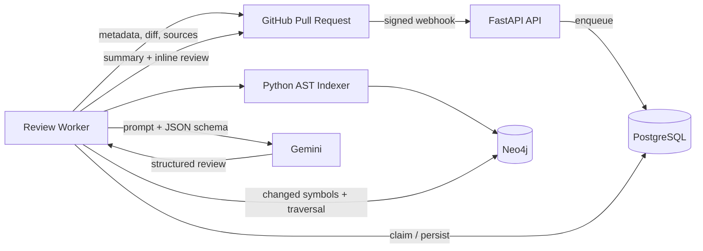
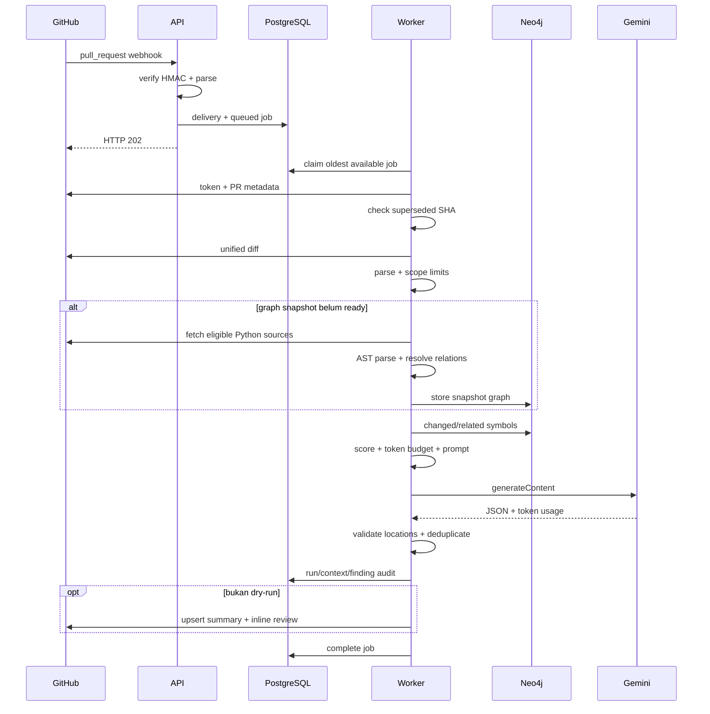

# Arsitektur high-level

## Tujuan

GraphMethod menjalankan code review otomatis untuk pull request GitHub. GitHub menjadi antarmuka pengguna: hasil berupa sticky summary, inline review comments, dan opsional suggested change. Aplikasi tidak memiliki dashboard dan tidak melakukan commit atau mengeksekusi source repository.

## Komponen runtime

| Komponen | Peran |
|---|---|
| FastAPI | Memverifikasi webhook dan membuat job; review berat tidak berjalan di request thread. |
| PostgreSQL | Menyimpan delivery, job, run, kandidat context, finding, status, dan metrics. |
| Worker | Mengorkestrasi GitHub, indexing, retrieval, model, persistence, publishing, dan retry. |
| GitHub API | Memberi installation token, metadata PR, unified diff, snapshot source, dan endpoint publish. |
| AST indexer | Mengekstrak simbol dan relasi statis Python tanpa menjalankan source. |
| Neo4j | Menyimpan graph per repository/commit dan mencari context di sekitar simbol berubah. |
| Gemini | Menghasilkan summary/findings dengan structured JSON output. |

## Alur end-to-end

## Trust boundary

- Header `X-Hub-Signature-256` harus cocok dengan HMAC-SHA256 body mentah.
- Judul/body PR, diff, source, comments, dan dokumentasi dianggap untrusted data. Prompt melarang model mengikuti instruksi di dalamnya.
- GitHub App hanya perlu `Contents: Read` dan `Pull requests: Read and write`; source tidak ditulis.
- Source diunduh dan diparse dengan `ast`, tidak di-import atau dieksekusi.
- Secret berasal dari environment atau Docker secret file dan komunikasi eksternal menggunakan HTTPS.

## Karakter desain

- **Asinkron dan durable:** API segera mengembalikan `202`; PostgreSQL menjadi queue persisten.
- **Idempotent sebagian:** delivery ID dan target repository/PR/head SHA unik; inline finding memakai fingerprint.
- **Snapshot-aware:** isi graph diisolasi per repository ID dan commit SHA.
- **Provider-agnostic:** orkestrator bergantung pada protocol `ReviewProvider`, meski registry saat ini hanya mendukung Gemini.
- **Conservative publishing:** finding tanpa changed line valid diturunkan menjadi general finding.

Exception menandai `ReviewRun` gagal dan diteruskan ke worker. Worker melakukan exponential backoff hingga batas attempt; setelah itu job menjadi `failed`.
