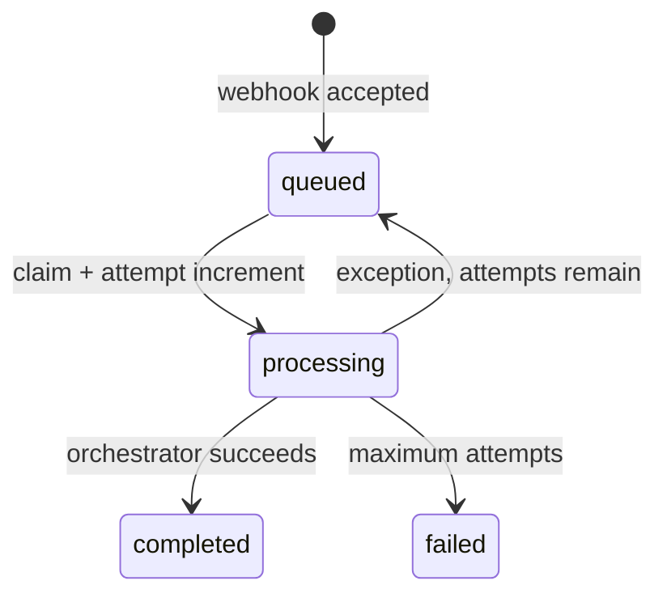

# Desain low-level

## Komposisi process

API dan worker adalah dua process berbeda tetapi membangun dependency yang sama: `Settings`, `Database`, dan `GraphStore`. Worker menambahkan `GitHubClient`, provider, `JobQueue`, dan `ReviewOrchestrator`.

### API

`main.py` membuat schema SQL dan constraint Neo4j saat startup, memasang router webhook, lalu menyediakan:

- `GET /health/live`: process hidup.
- `GET /health/ready`: PostgreSQL dapat menjalankan `SELECT 1` dan Neo4j dapat diverifikasi.
- `POST /webhooks/github`: penerimaan event.

### Webhook dan enqueue

`webhooks.py` memeriksa signature pada body mentah, header, dan JSON. Queue menerima
`pull_request` (opened/synchronize/reopened/ready_for_review) serta `issue_comment.created`
berisi `/review` dari kolaborator PR. Webhook tidak memanggil API GitHub.

Dua lapis deduplikasi tersedia:

1. `WebhookDelivery.delivery_id` adalah primary key, sehingga redelivery yang sama tidak membuat job baru.
2. Unique constraint `(repository_id, pull_request_number, head_sha, request_key)`
   mencegah job otomatis ganda. Partial unique index repository/request_key mencegah
   komentar manual yang sama diproses ulang setelah head SHA diresolusikan.

## State machine job



Claim memakai transaksi `SELECT ... FOR UPDATE SKIP LOCKED`, mengurutkan `created_at`, dan hanya memilih job dengan `available_at <= now`. Beberapa worker dapat aktif tanpa memproses row yang sama. Retry dijadwalkan `2 ** attempt` detik; karena attempt pertama bernilai 1, jeda awal adalah 2 detik.

`superseded` merupakan status `ReviewRun`, bukan status final `ReviewJob`. Jika head SHA terbaru berbeda dari SHA job, run ditandai superseded dan `execute()` selesai normal; worker kemudian menandai job completed.

## ReviewOrchestrator

Urutan `ReviewOrchestrator.execute()`:

1. Membuat `ReviewRun(status=processing)` dengan provider dan model aktif.
2. Meminta installation token lalu metadata PR.
3. Memastikan job belum superseded.
4. Mengambil dan memparse unified diff.
5. Menolak diff di atas `MAX_CHANGED_FILES` atau `MAX_CHANGED_LINES`.
6. Membuat snapshot graph jika repository/head SHA belum berstatus ready.
7. Mengambil kandidat context dan memilih subset berdasarkan budget.
8. Menyusun prompt dan memanggil provider.
9. Memvalidasi, menormalisasi, dan mendeduplikasi finding.
10. Menyimpan metrics, semua kandidat, subset terpilih, dan finding.
11. Memublikasikan hasil kecuali `DRY_RUN=true`.

## Data model PostgreSQL

| Tabel | Isi |
|---|---|
| `webhook_deliveries` | Payload mentah, event/action, waktu penerimaan. |
| `review_jobs` | Target repository/PR/SHA, status, attempt, retry schedule, error. |
| `review_runs` | Provider/model/prompt version, token usage, latency, status. |
| `review_findings` | Fingerprint, lokasi, severity, category, title, rendered body. |
| `retrieved_contexts` | Symbol, relation, distance, rank, token count, flag selected. |

Run baru mencatat `prompt_version=smp-v3`. `review_evaluations` menyimpan SHA,
skor, threshold, status kelulusan, konfigurasi, coverage dan jumlah konteks.

Claim PostgreSQL diserialisasi melalui advisory lock singkat dan hanya satu job per PR
dapat processing. Worker membatasi satu attempt dengan `WORKER_JOB_TIMEOUT_SECONDS`
(default 90). Job processing yang lease-nya habis direqueue setelah timeout + 30 detik.

## Parsing diff dan lokasi finding

`parse_unified_diff()` membaca header file/hunk. Baris tambah dicatat sebagai side `RIGHT` dengan new-file line number; baris hapus sebagai `LEFT` dengan old-file line number.

Path keluaran model dinormalisasi dengan menghapus prefix `a/` atau `b/`. Finding hanya inline bila path dan line cocok dengan changed line. Range multi-line harus berakhir pada side yang sama. Jika lokasi invalid, start/end line dan suggestion dihapus agar finding menjadi general finding.

Fingerprint adalah SHA-256 dari:

```text
path | original start_line | lowercase category | normalized lowercase title
```

Fingerprint membuang duplikasi dalam satu response dan mencegah inline comment yang sama dipublish ulang.

## Publishing

- Sticky summary memakai marker `<!-- graphmethod-ai-review-summary -->` dan di-update bila comment bot sudah ada.
- Inline findings digabung dalam satu Pull Request Review dengan event `COMMENT`.
- Suggestion hanya menjadi fenced `suggestion` jika exact replacement dan lokasi valid.
- Finding non-inline masuk ke `General findings` pada summary.
- `DRY_RUN=true` tetap menjalankan retrieval, Gemini, dan persistence; hanya write ke GitHub dilewati.

## Error propagation

Orkestrator menangkap exception, menandai run `failed`, menyimpan pesan maksimal 4.000 karakter, lalu melempar ulang. Worker menentukan retry atau terminal failure. Adapter Gemini membedakan rate limit, HTTP error, dan invalid structured output, tetapi semuanya saat ini mengikuti retry policy job yang sama.
