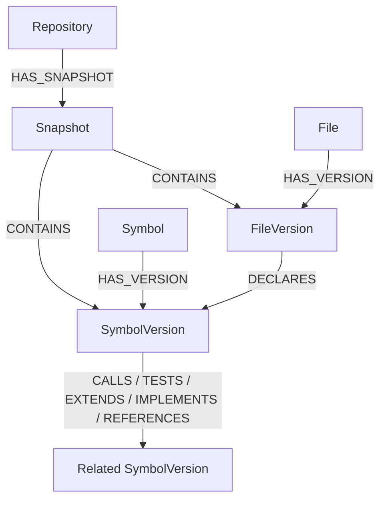

# Indexing dan graph retrieval

## Mengapa graph dipakai

Unified diff menjelaskan perubahan lokal, tetapi defect dapat bergantung pada caller, implementation, base class, reference, atau test di luar diff. Graph retrieval menambahkan potongan kode yang terhubung secara struktural tanpa mengirim seluruh repository.

Sistem tidak memakai embedding/vector similarity. Retrieval berbasis AST Python, relasi nama, lokasi changed line, dan traversal Neo4j.

## Membentuk snapshot

Jika `Snapshot` untuk `repository_id:head_sha` belum `ready`, worker:

1. Meminta recursive Git tree pada head SHA.
2. Memilih blob `.py` dan mengabaikan cache, virtual environment, build output, serta file excluded lain di `github.py`.
3. Menolak tree GitHub yang truncated, file di atas `MAX_SOURCE_FILE_BYTES`, atau jumlah file di atas `MAX_REPOSITORY_FILES`.
4. Mengunduh blob base64 dan decode UTF-8.
5. Memparse memakai `ast.parse`; file dengan `SyntaxError` dilewati.

## Ekstraksi simbol dan relasi

`PythonAstIndexer` membuat simbol class, function, method, dan test function berprefix `test_`. Simbol menyimpan path, qualified name, kind, signature, source segment, line range, dan content hash. Stable ID dasarnya `path:qualified_name`; version ID menambahkan repository dan snapshot SHA.

| Relasi | Sumber |
|---|---|
| `CALLS` | Call expression di function/method. |
| `TESTS` | Call expression dari test function. |
| `EXTENDS` | Base class biasa. |
| `IMPLEMENTS` | Base yang nama akhirnya menyerupai Protocol/Interface. |
| `REFERENCES` | Nama yang dibaca dalam body simbol. |

Resolusi target konservatif: leaf name harus unik secara global, atau unik di file yang sama. Dynamic dispatch, alias kompleks, monkey patching, dan refleksi tidak dapat diselesaikan penuh.

## Bentuk graph



Stable nodes mempertahankan identitas lintas commit; version nodes mengisolasi isi dan relasi pada SHA tertentu. Snapshot berstatus `building` sampai file, simbol, dan relasi selesai disimpan, lalu menjadi `ready`.

## Seed dari diff

Retriever membentuk map `path -> set(new changed line)`. `changed_symbols()` mencari `SymbolVersion` yang line range-nya mencakup changed line. Jika suatu path tidak cocok dengan simbol mana pun, fallback mengambil maksimal tiga simbol terkecil di path tersebut.

Seed selalu menjadi kandidat:

```text
relation = CHANGED_SYMBOL
distance = 0
score = 1.0
```

## Traversal context

Dari version ID seed, Neo4j menelusuri hubungan secara dua arah sejauh `GRAPH_MAX_HOPS` (1 atau 2):

```cypher
MATCH path = (seed)-[:CALLS|IMPLEMENTS|EXTENDS|REFERENCES|TESTS*1..N]-(related)
WHERE related.repository_id = $repository_id
  AND related.snapshot_sha = $sha
```

Traversal dua arah memungkinkan caller maupun callee masuk context. Hasil diurutkan berdasarkan distance dan dibatasi `jumlah_seed * GRAPH_MAX_NODES_PER_SYMBOL`.

## Scoring dan token budget

| Relasi | Skor |
|---|---:|
| `IMPLEMENTS` | 0,95 |
| `CALLS` | 0,90 |
| `TESTS` | 0,85 |
| `EXTENDS` | 0,82 |
| `REFERENCES` | 0,70 |
| tidak dikenal | 0,55 |

Path multi-hop memakai skor relasi tertinggi, dikurangi 0,18 untuk setiap hop setelah hop pertama, minimum 0,1. Token diestimasi sebagai `ceil(character_count / 4)`.

Kandidat diurutkan berdasarkan skor menurun lalu token count menaik. Pemilihan greedy melewati simbol duplikat atau item yang tidak lagi muat. Budget graph:

```text
max(1.000, CONTEXT_TOKEN_BUDGET - estimated_diff_tokens)
```

`build_prompt()` secara terpisah membatasi diff ke sekitar 65% total budget. Karena keduanya memakai heuristik karakter/4 dan metadata/instruksi tidak dihitung, total prompt adalah perkiraan, bukan hard tokenizer limit.

## Audit dan fallback

Semua kandidat disimpan di `retrieved_contexts`, termasuk rank, relation, distance, estimated token count, dan flag `selected`. Jika tidak ada context, prompt tetap dikirim dengan `No additional graph context found.` dan review berjalan dari diff saja.
